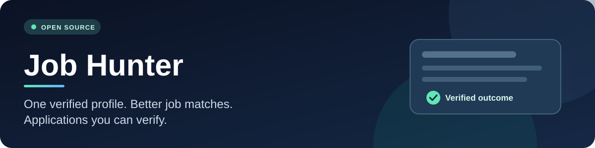
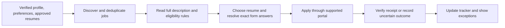

# Job Hunter



**A work-in-progress, open-source job search assistant.** Job Hunter explores job discovery, resume matching, application form handling, and proof-backed tracking. The goal is a plug-and-play workflow: enter your information and preferences once, connect the services you choose, and let the assistant handle the repeatable work accurately.

[](https://github.com/himanshugargnmims-cyber/job-hunter/actions/workflows/python-app.yml)
[](LICENSE)


> [!IMPORTANT]
> **This is a prototype, not a hands-off application service.** Several job-search paths are not connected end to end. Form answers, account flows, and submission states still need validation against live sites. Review every application before treating it as sent.

## The product we are building

A user should be able to provide:

- A verified career profile and approved resume variants.
- Preferred roles, industries, locations, remote eligibility, salary expectations, and exclusions.
- Optional access to job portals and email used for applications.

Job Hunter should then discover relevant openings, read the full job description, pick the appropriate resume, answer each form field in the format requested, handle supported account and email verification flows, and keep an evidence-backed record of what happened. It should stop and ask when a fact is missing, a portal blocks the flow, or the outcome cannot be confirmed.

The intended sources include company career pages and ATS boards, plus LinkedIn, IIMJobs, Naukri, and other portals where access and automation are supported. Coverage varies by source and is **not exhaustive today**.

## What is available today

| Area | Current state |
| --- | --- |
| Job discovery | Scripts for several direct ATS sources and portal searches exist. Source coverage and the main setup-to-search path are incomplete. |
| Resume matching | Heuristic matching can compare job text with PDF, TXT, or Markdown resume content. It does not yet guarantee correct routing for every role. |
| Applications | Experimental browser adapters exist for LinkedIn, IIMJobs, Naukri, and direct ATS forms. They need stronger field interpretation, eligibility checks, and live outcome verification. |
| Email verification | An IMAP-based helper exists for some OTP flows. There is no universal Gmail connection or account-creation workflow. |
| Tracking | Local SQLite and CSV-related code exists, with optional spreadsheet integration. A displayed status is not necessarily proof that a portal accepted an application. |
| RevOps toolkit | Separate forecasting, compensation, funnel, and deal desk examples are included in `revops_kit/`. They are demos, not required for the job-search workflow. |

See the [roadmap and release checks](docs/ROADMAP.md) for the concrete work between this prototype and a dependable plug-and-play experience.

## Target workflow



This diagram describes the **target design**. It is not a claim that every step works across every portal in the current code.

### Rules for a dependable application

1. **Use only verified facts.** Total experience, specialist experience, salary, work authorization, and contact details must come from the user's approved profile.
2. **Respect the field's unit and shape.** “Expected salary in lakhs” may require `55`; an INR field may require `5500000`. A numeric years-of-experience field needs a number, not a paragraph.
3. **Check eligibility before acting.** Location, remote policy, mandatory skills, duplicate applications, and company-specific application limits matter.
4. **Treat a result as confirmed only with evidence.** A final portal confirmation, application ID, or authoritative applied state should support a “submitted” label. An uncertain result stays uncertain.
5. **Make exceptions visible.** Captchas, unsupported forms, missing facts, failed verification, and ambiguous outcomes must be surfaced for review.

## Explore the code

The current CI exercises Python 3.10. Start with a virtual environment and these demo commands:

```bash
git clone https://github.com/himanshugargnmims-cyber/job-hunter.git
cd job-hunter
python3.10 -m venv .venv
source .venv/bin/activate
pip install -r requirements.txt
python run.py --help
python run.py --revops
```

On Windows, activate the environment with `.venv\Scripts\activate`. The RevOps command uses bundled sample data. Browser flows need Playwright's Chromium installation (`playwright install chromium`) and additional setup. **Do not use `--all` or `--apply` as unattended production commands yet.** The current `--stats` path is also not working.

### Repository map

| Path | Purpose |
| --- | --- |
| [`run.py`](run.py) | CLI entry point |
| [`scripts/`](scripts/) | Discovery, matching, form, and application experiments |
| [`revops_kit/`](revops_kit/) | Standalone RevOps examples |
| [`tests/`](tests/) | Existing test suite |
| [`docs/ROADMAP.md`](docs/ROADMAP.md) | Product milestones and acceptance checks |

## Privacy and contribution

Profiles, resumes, email access, and portal sessions can contain sensitive information. Use fake data in issues, tests, and demos. Keep credentials in local environment configuration and inspect `.gitignore` before adding any files; ignore rules are not a security boundary.

Contributions are welcome, especially reproducible fixes for form semantics, source coverage, application proof, and fresh-user setup. Read [CONTRIBUTING.md](CONTRIBUTING.md) and include a safe fixture or clear reproduction when reporting a portal issue. The [launch plan](docs/LAUNCH_PLAN.md) explains where we plan to share the prototype and what needs to work before a broader launch.

The separate RevOps references remain available in the [playbook](docs/REVOPS_PLAYBOOK.md) and [resource guide](docs/AWESOME_REVOPS.md).

Licensed under [MIT](LICENSE).
